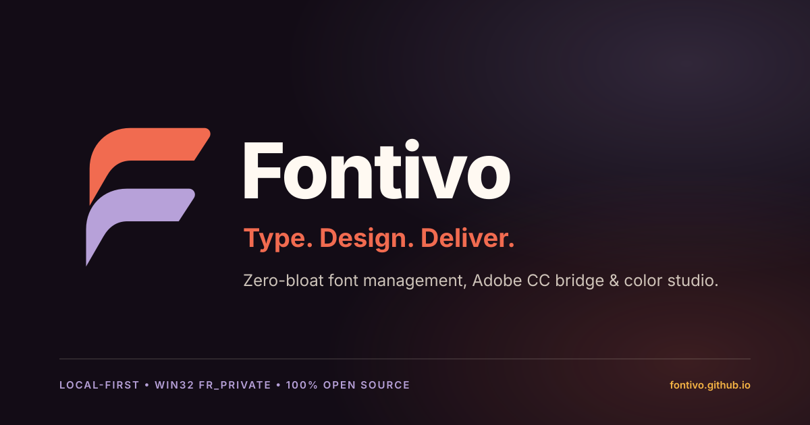
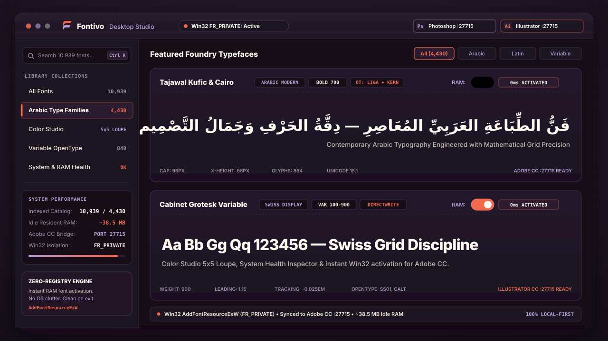
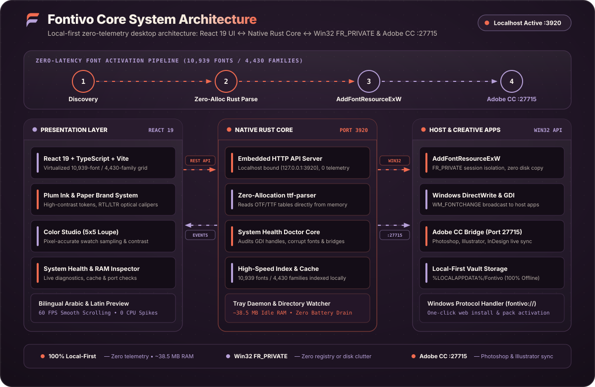

<a id="readme-top"></a>

<div align="center">

<a href="https://fontivo.github.io">
  
</a>

<br><br>

# Fontivo-Site — Official Web Portal, Documentation & Release Hub

**The bilingual (`/en` & `/ar` RTL), static-exported Next.js 15 web platform, interactive showcase, SEO/GEO knowledge portal, and SHA-256 verified distribution hub for the entire Fontivo typography ecosystem.**

<br>

[](https://fontivo.github.io)
[](https://nextjs.org/)
[](src/)
[-B7A1D9?style=for-the-badge&labelColor=130C16)](src/locales/)
[](LICENSE)

<br>

[-B7A1D9?style=flat-square&labelColor=130C16)](#testing--verification)
[](#routes--localization-architecture)
[](https://github.com/Ahmedfahmy8308/Fontivo-Fonts)
[](SECURITY.md)

<br>

<table align="center">
  <tr>
    <td align="center" width="210"><h3>18 Static Pages</h3><sub>Pre-rendered App Router SSG<br>(<code>/</code>, <code>/en/*</code>, <code>/ar/*</code>)</sub></td>
    <td align="center" width="210"><h3>10,939 Fonts</h3><sub>Synced from <code>v1.0.3</code> release<br>(4,430 families / 15 packs)</sub></td>
    <td align="center" width="210"><h3>SHA-256 SSOT</h3><sub>Single source installer hashes<br>(Windows Setup &amp; Unix CLI)</sub></td>
    <td align="center" width="210"><h3>SEO + GEO</h3><sub>Structured JSON-LD, OpenGraph,<br><code>llms.txt</code> &amp; <code>manifest.json</code></sub></td>
  </tr>
</table>

<br>

[**Live Showcase**](#interactive-product-showcase) &nbsp;•&nbsp;
[**Ecosystem & Architecture**](#ecosystem--system-architecture) &nbsp;•&nbsp;
[**Performance**](#performance-benchmarks) &nbsp;•&nbsp;
[**Routes & i18n**](#routes--localization-architecture) &nbsp;•&nbsp;
[**SSOT & Downloads**](#single-source-of-truth--cross-repo-sync) &nbsp;•&nbsp;
[**SEO & GEO**](#seo-open-graph--geo-endpoints) &nbsp;•&nbsp;
[**Design System**](#design-system--color-palette) &nbsp;•&nbsp;
[**Development**](#local-development--verification) &nbsp;•&nbsp;
[**Developers**](#development-team)

</div>

---

## Overview

**Fontivo-Site** serves as the public gateway to the **Fontivo** creative suite, engineered for zero-latency static hosting on GitHub Pages while keeping live release metrics, checksums, bilingual documentation, and font pack directories synchronized with the native desktop application and curated font archive repositories.

| Component | Repository | Role in Ecosystem |
| :--- | :--- | :--- |
| **Fontivo Desktop** | [Ahmedfahmy8308/Fontivo](https://github.com/Ahmedfahmy8308/Fontivo) | Native Rust + React 19 application (`Win32 FR_PRIVATE` RAM font injection & Adobe CC `:27715` bridge) |
| **Fontivo-Fonts** | [Ahmedfahmy8308/Fontivo-Fonts](https://github.com/Ahmedfahmy8308/Fontivo-Fonts) | Consolidated `v1.0.3` distribution of **10,939** deduplicated fonts across **4,430** families and **15** SHA-256 verified ZIP packs |
| **Fontivo-Site** *(this repo)* | [Ahmedfahmy8308/Fontivo-Site](https://github.com/Ahmedfahmy8308/Fontivo-Site) | Bilingual web showcase, interactive typography & contrast preview, documentation, and verified release download portal |

---

## Interactive Product Showcase

The web portal mirrors Fontivo's real desktop studio capabilities—interactive Arabic and Latin specimen switching, RAM virtualization simulation, Adobe Creative Cloud `:27715` status preview, live WCAG 2.1 contrast auditing, and animated vector showcase assets:

<div align="center">
  <a href="public/diagrams/fontivo-hero-demo.svg">
    
  </a>
  <p><em>Interactive desktop studio vector showcase embedded from <code>public/diagrams/fontivo-hero-demo.svg</code>.</em></p>
</div>

---

## Ecosystem & System Architecture

Everything displayed on the website—from the desktop **Win32 `AddFontResourceExW (FR_PRIVATE)`** activation model to the **Adobe Creative Cloud Port `27715`** live socket bridge—is documented visually and technically across the `/features` and `/docs` routes:

<div align="center">
  <a href="public/diagrams/architecture-diagram.svg">
    
  </a>
  <p><em>End-to-end architecture overview hosted under <code>public/diagrams/architecture-diagram.svg</code>.</em></p>
</div>

---

## Performance Benchmarks

Fontivo's core Rust daemon (~38.5 MB idle RAM and sub-millisecond RAM font injection) is compared cleanly against legacy Electron-based managers both in documentation and interactive feature showcases:

<div align="center">
  <a href="public/diagrams/benchmarks.svg">
    
  </a>
  <p><em>Benchmark visualization stored at <code>public/diagrams/benchmarks.svg</code>.</em></p>
</div>

---

## Routes & Localization Architecture

**Fontivo-Site** implements **slash-based static localization** (`src/app/[locale]/`) using statically generated parameters for English (`/en`) and Arabic RTL (`/ar`). Root `/` renders English directly at load time with **zero client-side redirect flash**.

| Route | Default (`/`) & English (`/en`) | Arabic RTL (`/ar`) | Purpose |
| :--- | :--- | :--- | :--- |
| **Home** | `/`, `/en` | `/ar` (`dir="rtl"`) | Hero studio preview, key benefits, interactive workspace tabs, 15-pack overview & developer credits |
| **Features** | `/en/features` | `/ar/features` | Filterable feature catalog, live bilingual WCAG specimen playground & visual SVG architecture section |
| **Download** | `/en/download` | `/ar/download` | Windows Setup Installer (`Fontivo-v1.0-Setup.exe`), macOS/Linux CLI installer (`install.sh`), SHA-256 copier & filterable 15 font packs |
| **Documentation** | `/en/docs` | `/ar/docs` | Quick-start installation, RAM virtualization (`FR_PRIVATE`), Adobe CC `:27715` setup, CLI & system guides |
| **About** | `/en/about` | `/ar/about` | Mission, open-source principles, ecosystem architecture & developer profiles |
| **FAQ** | `/en/faq` | `/ar/faq` | Interactive searchable FAQ covering licensing, privacy, offline fonts & Adobe integration |

Navigation is always accessible via a sticky desktop header with a direct **Home / الرئيسية** link, version tag, GitHub repository shortcut (`Ahmedfahmy8308/Fontivo`), and clean **Plum / Coral / Lavender** footer with direct developer portfolio links.

---

## Single Source of Truth & Cross-Repo Sync

Release numbers, file sizes, SHA-256 digests, script breakdowns, and repository coordinates are centralized inside **[`src/config/version.ts`](src/config/version.ts)** (`SSOT`). Components never hardcode version tags or checksums.

When releasing updates across the ecosystem:
1. Rebuilding `Fontivo-App/scripts/build-release.ps1` updates `Fontivo-v1.0-Setup.exe` size & SHA-256 → sync `src/config/version.ts` and `public/api/manifest.json`.
2. Updating diagrams in `Fontivo-App/assets/diagrams/*.svg` → sync copies into `public/diagrams/`.
3. Updating `Fontivo-Fonts` pack archives → sync library totals and pack definitions across `src/config/version.ts`, `src/config/releases.ts`, `public/api/manifest.json`, and `public/llms.txt`.

> [!NOTE]
> Windows users receive the dedicated **Windows Setup Installer** (`Fontivo-v1.0-Setup.exe`), while macOS and Linux tabs present the unified native `install.sh` workflow. Live release metadata and GitHub download counters are hydrated progressively with static fallbacks via [`src/lib/github.ts`](src/lib/github.ts).

---

## SEO, Open Graph & GEO Endpoints

Fontivo-Site is optimized for both classic search engines (SEO) and AI/LLM generative discovery (GEO):

- **Per-Route Metadata & Alternates**: Every page exports `generateMetadata` via [`src/lib/seo.ts`](src/lib/seo.ts) with localized titles, descriptions, canonical URLs, `hreflang` alternates (`en`, `ar`), OpenGraph artwork (`og-image.png` / `og-image.svg`), and Twitter cards.
- **Structured Schema (`JSON-LD`)**: `SoftwareApplication` schema injected at the root layout.
- **Crawl Directives**: [`src/app/robots.ts`](src/app/robots.ts) & [`src/app/sitemap.ts`](src/app/sitemap.ts) export `/robots.txt` and `/sitemap.xml`.
- **AI Discovery & Machine API**:
  - **[`public/llms.txt`](public/llms.txt)** — Clean Markdown summary tailored for LLM & agent indexing.
  - **[`public/api/manifest.json`](public/api/manifest.json)** — Machine-readable JSON feed of desktop platforms, installer SHA-256, `Fontivo-Fonts` counts, and developer metadata.

---

## Design System & Color Palette

All UI components, SVGs, cards, and badges adhere strictly to the **Fontivo Plum / Coral / Lavender** token architecture defined in [`src/app/globals.css`](src/app/globals.css) and [`tailwind.config.ts`](tailwind.config.ts):

| Token | Hex | Usage |
| :--- | :--- | :--- |
| **Deep Plum Canvas** | `#130C16` | Primary page background (`--bg-foundation`) |
| **Plum Surface** | `#1B1220` / `#291C2E` | Elevated cards, navbar backdrop & surfaces |
| **Fontivo Coral** | `#F16B50` | Primary actions, active highlights & CTA buttons |
| **Fontivo Lavender** | `#B7A1D9` | Secondary badges, developer accents & highlights |
| **Paper White** | `#FFF9F2` | High-contrast primary headings & body typography |

---

## Directory Structure

```text
Fontivo-Site/
├── .github/
│   ├── ISSUE_TEMPLATE/          # Bug report, feature request & cross-repo routing config
│   ├── workflows/ci-deploy.yml  # Automated Prettier, ESLint, Vitest, SSG Build & Pages Deploy
│   ├── FUNDING.yml              # Sponsor & developer links
│   └── PULL_REQUEST_TEMPLATE.md # Pre-merge i18n, SSOT & test verification checklist
├── public/
│   ├── api/manifest.json        # Machine-readable JSON API manifest
│   ├── brand/                   # Logos, favicons, animated SVG mark & OpenGraph banners
│   ├── diagrams/                # Animated showcase, architecture & benchmarks SVGs
│   ├── favicon.ico
│   └── llms.txt                 # GEO knowledge index for AI search engines
├── src/
│   ├── app/
│   │   ├── [locale]/            # Localized static pages (/en/* and /ar/*)
│   │   ├── globals.css          # Theme tokens & clip-safe sticky scroll styles
│   │   ├── layout.tsx           # Root HTML, fonts (Inter, Sora, Tajawal, Mono) & JSON-LD
│   │   ├── page.tsx             # Direct English root landing page (zero redirect flash)
│   │   ├── robots.ts            # Generated robots.txt
│   │   └── sitemap.ts           # Generated sitemap.xml
│   ├── components/
│   │   ├── about/               # AboutClient
│   │   ├── common/              # DevelopersSection, LanguageSwitcher
│   │   ├── docs/                # DocsClient (searchable technical docs)
│   │   ├── download/            # DownloadClient, DownloadHeader (OS tabs & 15-pack filter)
│   │   ├── faq/                 # FAQClient
│   │   ├── features/            # FeaturesClient, FeaturesHeader (SVG showcase & WCAG tester)
│   │   ├── home/                # Hero, BenefitsSection, ProductPreview, FontPackageSection, CtaBanner
│   │   ├── layout/              # Sticky Navbar, Footer
│   │   └── ui/                  # Badge, Button, Card, Container, SectionHeader
│   ├── config/                  # version.ts (SSOT), navigation.ts, site.ts, releases.ts, features*, faq.ts
│   ├── context/                 # LanguageContext (/en & /ar RTL direction management)
│   ├── lib/                     # seo.ts, github.ts, wcag.ts, utils.ts
│   └── locales/                 # Full English (en.ts) & Arabic (ar.ts) translation dictionaries
├── tests/                       # 17 Vitest suites (69 unit, i18n, SEO, WCAG & UI tests)
├── AGENT.md                     # Cross-repo scope & AI agent operational rules
├── CODE_OF_CONDUCT.md           # Contributor Covenant v2.1
├── CONTRIBUTING.md              # Contributor setup & quality guidelines
├── LICENSE                      # MIT License
└── SECURITY.md                  # Zero-tracking privacy & SHA-256 verification policy
```

---

## Local Development & Verification

### Prerequisites
- **Node.js**: 18.x or 20.x+
- **npm**: 9.x+

### Quick Start

```bash
# Install dependencies
npm install

# Run local development server (http://localhost:3000)
npm run dev
```

### Testing & Verification

Every pull request and release build runs the complete verification pipeline:

```bash
# 1. Verify Prettier formatting across src/ and tests/
npm run format:check

# 2. Run ESLint static analysis
npm run lint

# 3. Execute all 17 Vitest suites (69 tests covering UI, i18n, WCAG, SEO & GitHub APIs)
npm test

# 4. Build optimized Next.js 15 static export (generates 18 static pages in out/)
npm run build
```

---

## Development Team

- **Eng. Ahmed Fahmy** — *Technology & Programming* • [ahmed-fahmy.engineer](https://ahmed-fahmy.engineer/) • [GitHub (@Ahmedfahmy8308)](https://github.com/Ahmedfahmy8308)
- **Eng. Mohamed Elashwah** — *Brand Identity & Fonts* • [mohamed-elashwah.me](https://mohamed-elashwah.me/)

---

## License

Released under the [MIT License](LICENSE). See [`LICENSE`](LICENSE) for full legal terms.

<div align="center">
  <sub><a href="#readme-top">Back to Top ↑</a></sub>
</div>
